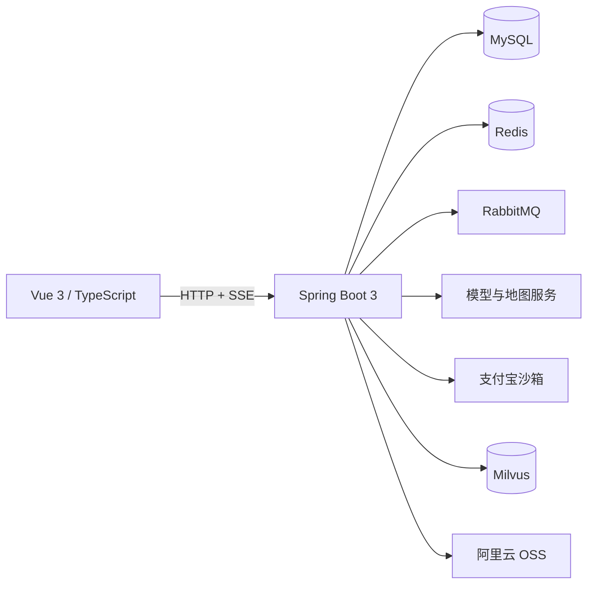

# 出发啦 Chufala

一个围绕「找目的地、做行程、订酒店」展开的全栈旅行项目。它将景点与酒店浏览、AI 行程规划、旅行问答和酒店预订放在同一条用户路径中，也把异步任务、缓存、库存、支付这些真实业务问题落到了代码里。

> 接入了模型、地图、OSS、邮件和支付宝沙箱等外部服务；完整运行需要准备相应服务、凭据和基础数据，详见[运行前须知](#运行前须知)。

## 可以体验什么

- **旅行规划**：输入目的地和出行偏好，系统从站内景点、酒店数据获取候选项，依次规划景点、生成天气参考、估算相邻景点距离、推荐酒店并估算预算；前端展示分阶段进度和最终行程。天气来自模型生成，路程时间基于直线距离估算，不应作为实时天气或导航结果。
- **旅行助手**：支持流式对话、会话历史、关联已有行程提问，以及景点、订单等业务工具调用。
- **景点与酒店**：浏览、筛选和查看详情；酒店支持按入住日期选择房型、创建订单和查询订单。
- **沙箱支付**：酒店订单接入支付宝沙箱；支付结果以服务端异步通知为准，浏览器回跳只负责返回页面。

## 技术亮点

| 场景 | 设计与实现 | 代码入口 |
| --- | --- | --- |
| AI 行程规划 | 用 LangGraph4j 将候选数据、行程、天气、路程、酒店和预算组织成六节点流水线；任务交给专用线程池异步执行，完成后保存历史结果。 | [AgentService](chufala-backend/chufala-web/src/main/java/com/hope/chufala/agent/AgentService.java) |
| 长任务可观测性 | Redis 保存规划任务与事件；SSE 推送阶段进度，支持 `Last-Event-ID` 补发，并校验任务所属用户。聊天流也有独立的事件续传机制。 | [进度流管理](chufala-backend/chufala-web/src/main/java/com/hope/chufala/infra/stream/PlanProgressStreamManager.java) · [聊天流管理](chufala-backend/chufala-web/src/main/java/com/hope/chufala/infra/stream/ChatStreamManager.java) |
| 热点查询与分页 | 列表采用游标分页；景点首页使用 Caffeine + Redis 两级缓存，更新时通过版本切换和 Redis 通知失效；详情查询包含空值缓存、逻辑过期与异步重建。 | [景点列表缓存](chufala-backend/chufala-web/src/main/java/com/hope/chufala/infra/cache/AttractionListCache.java) · [缓存工具](chufala-backend/chufala-web/src/main/java/com/hope/chufala/infra/cache/CacheClient.java) |
| 酒店库存与超时关单 | 下单在事务中按入住日期逐晚条件扣库存，任一晚不足即回滚；订单提交后投递 RabbitMQ 延迟消息，定时任务兜底。取消前查询并关闭渠道侧待支付交易，避免本地释放库存后支付仍能完成。 | [酒店订单服务](chufala-backend/chufala-web/src/main/java/com/hope/chufala/service/impl/HotelOrderServiceImpl.java) · [关单保护](chufala-backend/chufala-web/src/main/java/com/hope/chufala/service/impl/HotelPaymentCloseGuard.java) |
| 支付回调幂等 | 校验支付宝签名、应用与收款方、订单号及金额；支付记录唯一约束与订单条件更新共同处理重复通知、超时取消与支付竞争。 | [支付服务](chufala-backend/chufala-web/src/main/java/com/hope/chufala/service/impl/AlipayServiceImpl.java) · [数据库结构](chufala-backend/db/chufala_db.sql) |

以上是代码中的设计与边界处理，不代表已经完成生产环境压测或真实支付上线。

## 系统结构



| 层次 | 主要技术 |
| --- | --- |
| 前端 | Vue 3、TypeScript、Vite、Pinia、Vue Router、Element Plus、ECharts |
| 后端 | Java 17、Spring Boot 3.5、Spring AI、LangGraph4j、MyBatis-Plus |
| 数据与消息 | MySQL、Redis、Caffeine、RabbitMQ；Milvus 用于向量检索实验接口 |
| 外部能力 | 高德地图 MCP 接入代码、模型服务、支付宝沙箱、阿里云 OSS、SMTP |

> Milvus 已有配置与检索测试接口，目前不应将它理解为完整的线上 RAG 产品链路。高德地图 MCP 接入代码目前没有用于行程规划的路程估算。

```text
.
├── chufala-frontend/             Vue 前端与可选的分享截图服务
├── chufala-backend/
│   ├── chufala-common/           通用模型、工具与异常处理
│   ├── chufala-web/              API、业务服务、AI 编排与基础设施
│   └── db/chufala_db.sql         MySQL 完整表结构
└── README.md
```

## 运行前须知

1. 准备 **JDK 17**、**Node.js 20.19+ 或 22.12+**（见前端 `package.json`），以及 MySQL、Redis、RabbitMQ、Milvus。RabbitMQ 的酒店订单延迟交换机依赖 delayed-message 插件和 `/chufala` virtual host。
2. 使用 [完整表结构](chufala-backend/db/chufala_db.sql) 初始化一个**新建的空** `chufala_db` 数据库。该文件包含 `DROP TABLE IF EXISTS`，会删除目标库中同名表及其数据，不能直接用于升级已有业务数据库。结构文件不包含演示数据，体验景点与酒店功能还需自行导入业务数据。
3. 准备所需第三方服务的账号和凭据。后端配置模板引用多个环境变量，缺少必需服务或密钥时，应用可能无法启动或相应功能不可用。
4. 支付宝异步通知需要公网可访问的 `POST /alipay/notify` 地址；本地浏览器回跳不能替代异步通知。

### 本地启动

先在仓库根目录创建并初始化 MySQL 8 数据库（将 `YOUR_USER` 替换为本地账号，两条命令都会提示输入密码）：

```bash
mysql -u YOUR_USER -p -e "CREATE DATABASE chufala_db CHARACTER SET utf8mb4 COLLATE utf8mb4_0900_ai_ci"
mysql -u YOUR_USER -p chufala_db -e "source chufala-backend/db/chufala_db.sql"
```

再复制配置模板：

```bash
cp chufala-backend/chufala-web/src/main/resources/application.yml.example chufala-backend/chufala-web/src/main/resources/application.yml
cp chufala-backend/chufala-common/src/main/resources/application.yml.example chufala-backend/chufala-common/src/main/resources/application.yml
cp chufala-backend/chufala-web/src/main/resources/mcp-servers-config.json.example chufala-backend/chufala-web/src/main/resources/mcp-servers-config.json
cp chufala-frontend/.env.example chufala-frontend/.env.development
```

按本地服务地址修改上述副本并设置环境变量。PowerShell 也可使用 `cp`（`Copy-Item` 的别名）。这些真实配置文件不会被 Git 跟踪。主要配置项如下：

| 类别 | 环境变量 |
| --- | --- |
| 数据与消息 | `MYSQL_USERNAME`、`MYSQL_PASSWORD`、`RABBITMQ_USERNAME`、`RABBITMQ_PASSWORD`、`DRUID_USERNAME`、`DRUID_PASSWORD` |
| AI 与地图 | `AI_DASHSCOPE_API_KEY`、`ZHIPU_API_KEY`、`DEEPSEEK_API_KEY`、`DOUBAO_API_KEY`、`AMAP_MAPS_API_KEY` |
| 支付 | `ALIPAY_APP_ID`、`ALIPAY_SELLER_ID`、`ALIPAY_MERCHANT_PRIVATE_KEY`、`ALIPAY_PUBLIC_KEY`、`ALIPAY_NOTIFY_URL`、`ALIPAY_RETURN_URL`、`ALIPAY_FRONTEND_RETURN_URL` |
| 其他 | `ALIYUN_OSS_ACCESS_KEY_ID`、`ALIYUN_OSS_ACCESS_KEY_SECRET`、`SMTP_USER`、`SMTP_PASSWORD`、`JWT_ACCESS_TOKEN_SECRET`、`JWT_REFRESH_TOKEN_SECRET`、`PRICE_SIGN_SECRET_KEY` |

前端地图变量位于 `.env.development`：`VITE_BAIDU_MAP_AK`、`VITE_AMAP_API_KEY`、`VITE_AMAP_SERVICE_KEY`、`VITE_AMAP_SECURITY_CODE`。`VITE_*` 值会进入浏览器产物，务必在地图平台配置域名或 Referer 白名单。后端 MCP 配置副本中的 `AMAP_MAPS_API_KEY` 也需按实际运行方式配置。

启动后端（Windows 使用 `mvnw.cmd`，macOS/Linux 使用 `./mvnw`）：

```bash
cd chufala-backend
./mvnw -pl chufala-web -am spring-boot:run
```

另开终端启动前端：

```bash
cd chufala-frontend
npm ci
npm run dev
```

默认前端地址为 `http://localhost:8881`，`/api` 代理到后端 `http://localhost:9010`。本地 HTTPS 需要另行配置，参见[证书说明](chufala-frontend/HTTPS_CERT_GUIDE.md)。前端的分享截图服务位于 [`chufala-frontend/server`](chufala-frontend/server)，需要时单独安装依赖并运行 `node index.js`（默认端口 `3000`）。

### 验证与测试

```bash
cd chufala-frontend
npm run build
```

```bash
cd chufala-backend
./mvnw -pl chufala-web -am test
```

后端测试覆盖任务进度续传、缓存、游标分页、酒店库存和支付回调等场景。部分集成测试或本地运行依赖相应的基础设施和配置。

## 酒店订单与支付边界

- 逐日库存以 `room_daily_stock` 为准，`room.stock` 仅表示房型基准房量。创建订单时整笔预订处于一个事务；支付只允许“待支付 → 已支付”，取消只允许“待支付 → 已取消”，成功取消后才回补库存。
- 延迟消息负责触发约 30 分钟后的超时处理，定时任务每分钟扫描兜底。**释放库存之前必须确认支付宝交易已关闭或不会再被支付**；渠道状态不确定时保留库存，等待重试或人工核查。
- 支付页面显示成功或浏览器回到网站，都不等于后端已经收到异步通知。排查时先检查通知地址、回调日志和渠道交易状态；已付款但本地仍待支付的订单应先对账，避免让用户重复付款。
- 对已取消但确认付款的订单，支付记录标为 `REFUND_REQUIRED`。**目前没有自动退款**，需要在支付宝后台核实并人工处理，之后再将记录更新为 `REFUNDED`。
- 当前 SQL 文件是新库结构快照，不提供已有数据库的原地升级能力。若需要迁移历史订单与支付记录，需单独设计数据迁移和对账流程，尤其不能直接释放旧待支付订单占用的库存。

## 当前限制与后续方向

- 补齐演示数据、容器编排和一键启动流程，降低复现门槛。
- 补全自动退款、失败重试与支付对账；目前退款待办需要人工处理。
- 增加端到端验证与压测数据，量化缓存、分页和 SSE 在并发场景下的效果。
- 若计划按开源许可证对外发布，需要另行添加 `LICENSE` 并明确使用范围。

欢迎通过 Issue 讨论设计、复现问题与改进建议。提交代码前请运行相关构建或测试，并确保配置模板和实际代码同步更新；不要提交密钥、私钥或真实账号密码。
